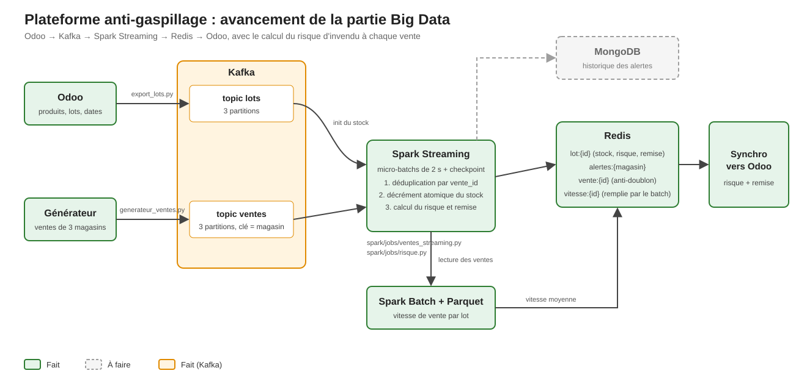

# Rapport d'avancement – Partie Big Data

## 1. Objectif
Détecter en temps réel les lots de produits périssables qui ne seront pas vendus avant leur date limite, et recommander une remise. Le flux est le suivant : **Odoo → Kafka → Spark Streaming → Redis → Odoo**.

**Rôle de chaque brique.** Kafka reçoit les événements (lots et ventes) et les garde, ce qui permet de les rejouer. Spark les traite en continu. Redis garde l'état courant de chaque lot et répond très vite. Odoo affiche le résultat aux utilisateurs.

En vert ce qui est fait, en pointillés gris ce qui reste à faire.

## 2. Ce qui est réalisé

### a) Environnement reproductible
Un seul `docker compose up` démarre Kafka, Spark (master et worker), Redis, MongoDB, Odoo et PostgreSQL. Chaque conteneur a une limite de mémoire et les mots de passe sont dans un `.env` exclu de Git, pour qu'un autre poste puisse reproduire l'installation sans fuite de secrets.

Fichiers : [docker-compose.yml](docker-compose.yml), [.env.example](.env.example), [Makefile](Makefile), [spark/Dockerfile](spark/Dockerfile).

### b) Ingestion des données dans Kafka
- Les lots et leurs dates de péremption sont lus dans Odoo et publiés dans le topic `lots`.
- Un générateur simule les ventes de 3 magasins vers le topic `ventes`. Il est partitionné par magasin et vend le lot qui périme le plus tôt en premier, comme dans un vrai magasin. Il peut injecter des doublons pour tester la robustesse.

Fichiers : [scripts/export_lots.py](scripts/export_lots.py), [generator/generateur_ventes.py](generator/generateur_ventes.py).

### c) Traitement en continu avec Spark Structured Streaming
Au démarrage, le job lit le topic `lots` et crée les lots dans Redis sans écraser un stock existant, puis calcule le risque de tous les lots. Il lit ensuite `ventes` toutes les 2 secondes, avec un checkpoint pour reprendre après un arrêt.

Le stock de chaque lot est décrémenté dans Redis par un script Lua, ce qui rend l'opération atomique : deux ventes simultanées ne peuvent pas se marcher dessus. Une vente rejouée est reconnue par son `vente_id` et n'est jamais comptée deux fois. Le job tient aussi des statistiques (ventes appliquées, doublons, lots inconnus, messages illisibles), et ne recalcule le risque que pour les lots réellement modifiés.

Fichier : [spark/jobs/ventes_streaming.py](spark/jobs/ventes_streaming.py).

### d) Batch de vitesse de vente
Un job Spark relit tout l'historique des ventes dans Kafka, retire les doublons et ventes invalides, puis calcule pour chaque lot sa **vitesse de vente moyenne par jour** : quantité vendue divisée par le nombre de jours où il s'est vendu. Le résultat est archivé en Parquet et écrit dans Redis (`vitesse:{lot}`).

**Pourquoi ?** Sans cette vitesse réelle, le calcul de risque doit supposer une vitesse identique pour tous les produits, ce qui le rend peu fiable.

Fichier : [spark/jobs/vitesses_vente.py](spark/jobs/vitesses_vente.py).

### e) Calcul du risque
Pour chaque lot : invendus projetés = stock − vitesse × jours restants. Le taux d'invendus est ce chiffre divisé par le stock. Le niveau est *faible* (< 20 %), *à surveiller* (20 à 50 %) ou *élevé* (≥ 50 %). Pour un niveau élevé, la remise est de 20, 30 ou 50 % selon les jours restants (plus la date approche, plus la remise est forte).

La vitesse utilisée est celle du batch quand elle existe, sinon une valeur par défaut. Le résultat est écrit dans Redis (`risque:{id}`, `lot:{id}` et les listes d'alertes) après chaque vente et au démarrage.

Fichier : [spark/jobs/risque.py](spark/jobs/risque.py).

### f) Retour vers Odoo
Le script `sync_risque_odoo.py` copie le risque de Redis vers les lots d'Odoo, où un module sur mesure l'affiche (voir le rapport ERP). Exécuté : 150 lots mis à jour. La boucle complète est donc fermée.

Fichier : [scripts/sync_risque_odoo.py](scripts/sync_risque_odoo.py).

## 3. Exigences du cahier des charges couvertes

| Réf. | Exigence | Statut |
|---|---|---|
| EF1 | Ventes de chaque magasin dans Kafka en temps réel | Fait |
| EF2 | Décrément atomique du stock par lot | Fait |
| EF3 | Une vente rejouée n'est jamais comptée deux fois | Fait |
| EF4 | Risque recalculé en continu | Fait |
| EF5 | Remise recommandée pour les lots à risque élevé | Fait |
| EF6 | Batch de vitesse de vente | Fait, avec réserves (voir §4) |

## 4. Ce qui reste à faire

| Bloc | Contenu |
|---|---|
| Batch Spark | Le batch calcule la vitesse par lot, et non par produit, magasin et jour comme demandé. L'archive Parquet contient les vitesses, pas les ventes brutes. Il n'est pas planifié : il se lance à la main. Les trois points restent à compléter. |
| MongoDB | Stockage de l'historique des alertes, des lots et des vitesses de vente. Seule Redis est utilisée pour l'instant. |
| Benchmarks | Débit Kafka, latence, performances Redis et MongoDB, montée en charge, comparaison streaming contre batch. |
| Tests de panne | Arrêt d'un broker, d'un worker, de Redis et de MongoDB. Mesure du RTO (temps de reprise) et des ventes perdues ou doublées. Il faut aussi ajouter la réplication, absente aujourd'hui. |

## 5. Remarques
- Le job streaming se lance par `spark-submit` avec le connecteur Kafka. Il faut ajouter `--conf spark.jars.ivy=/tmp/.ivy2`, sinon le téléchargement des dépendances échoue (l'utilisateur `spark` n'a pas de dossier personnel).
- Lors du test, les lots du seed étaient déjà périmés : ils sont tous sortis en risque élevé (100 %, remise 50 %). Il faut des dates postérieures à aujourd'hui pour une démonstration variée.
- Le flux complet a été exécuté une fois (150 lots). Les performances n'ont pas encore été mesurées : les benchmarks et les tests de panne sont les prochaines étapes importantes.
