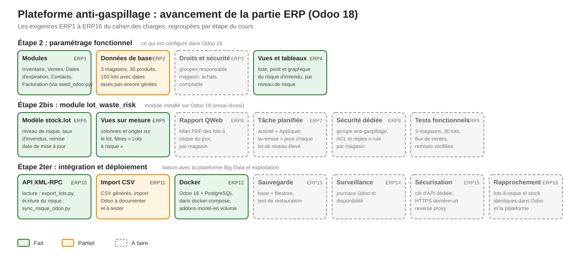

# Rapport d'avancement – Partie ERP (Odoo 18)

## 1. Objectif
Odoo reste le système de référence : il porte les produits, les magasins, les lots et leurs dates de péremption. La plateforme Big Data calcule le risque d'invendu de chaque lot, puis le renvoie dans Odoo pour que les responsables de magasin le voient directement dans leur outil habituel.

**Pourquoi cette organisation ?** Odoo sait gérer des stocks, mais pas analyser des milliers de ventes en continu. On lui laisse donc ce qu'il fait bien (les données de référence) et on confie le calcul à Spark. Le résultat revient ensuite dans Odoo, où il est utile.

En vert ce qui est fait, en orange ce qui est partiel, en pointillés gris ce qui reste à faire.

## 2. Ce qui est réalisé

### a) Déploiement avec Docker (ERP12)
Odoo 18 et PostgreSQL 16 tournent dans le même `docker-compose.yml` que le reste de la plateforme, avec une limite de mémoire. Le dossier `odoo/addons/` est monté en volume : Odoo y trouve le module sur mesure sans reconstruire l'image. Le mot de passe administrateur d'Odoo est stocké sous forme de hash dans `odoo.conf`.

Fichiers : [docker-compose.yml](docker-compose.yml), [odoo/config/odoo.conf](odoo/config/odoo.conf).

### b) Paramétrage et données de base (ERP1, ERP2)
Le script `seed_odoo.py` se connecte à Odoo par XML-RPC (l'API standard d'Odoo) et prépare tout :
- installation des modules Inventaire, Ventes, Dates d'expiration, Contacts et Facturation, puis activation du suivi par lots ;
- création de 3 magasins (entrepôts M1, M2, M3) ;
- création de 30 produits périssables répartis en 5 catégories (produits laitiers, boulangerie, viandes et poissons, fruits et légumes, plats frais), suivis par lot avec une durée de vie ;
- création de 150 lots avec leur date de péremption et leur stock initial.

Le script peut être relancé sans créer de doublon et reprend après une erreur. Les données sont reproductibles (même graine, mêmes données).

Fichiers : [scripts/seed_odoo.py](scripts/seed_odoo.py), [scripts/seed/produits.csv](scripts/seed/produits.csv), [scripts/seed/lots.csv](scripts/seed/lots.csv).

### c) Odoo vers la plateforme : lecture des lots (ERP10, première moitié)
Le script `export_lots.py` lit le stock et les dates de péremption des lots dans Odoo et les publie dans Kafka (topic `lots`). Spark s'en sert ensuite pour connaître chaque lot à surveiller. Cette étape a été exécutée : 150 lots publiés.

Fichier : [scripts/export_lots.py](scripts/export_lots.py).

### d) Module Odoo `lot_waste_risk` (ERP4, ERP5)
C'est la partie visible par les utilisateurs. Le module étend le modèle `stock.lot` d'Odoo avec sept champs en lecture seule : niveau de risque (faible, à surveiller, élevé), taux d'invendus projeté, invendus projetés, vitesse de vente, jours restants, remise recommandée et date de mise à jour.

Il ajoute :
- dans la **liste des lots**, des colonnes de risque et des lignes colorées (rouge pour un risque élevé, orange pour à surveiller) ;
- dans la **fiche d'un lot**, un onglet « Risque d'invendu » ;
- des **filtres** « Risque élevé », « À surveiller » et « Lots à risque » ;
- un menu **Inventaire > Rapports > Risque d'invendu**, avec une vue liste, une vue pivot et un graphique.

Les champs sont en lecture seule volontairement : seul le calcul de la plateforme les alimente, pour éviter qu'une saisie manuelle ne contredise le calcul. Le module s'installe sans erreur sur Odoo 18.

Fichiers : [odoo/addons/lot_waste_risk/](odoo/addons/lot_waste_risk/).

### e) Plateforme vers Odoo : écriture du risque (ERP10, seconde moitié)
Le script `sync_risque_odoo.py` lit dans Redis le résultat du calcul de chaque lot, puis l'écrit dans les champs du module par XML-RPC. Pour limiter le nombre d'appels, les lots qui ont exactement les mêmes valeurs sont mis à jour ensemble. Le script peut être relancé sans risque, et un mode `--dry-run` montre ce qui serait écrit sans rien modifier.

Il a été exécuté : 150 lots mis à jour dans Odoo. La boucle complète Odoo → Kafka → Spark → Redis → Odoo fonctionne donc.

Fichier : [scripts/sync_risque_odoo.py](scripts/sync_risque_odoo.py).

## 3. Exigences du cahier des charges

| Réf. | Exigence | Statut |
|---|---|---|
| ERP1 | Modules installés | Fait par script |
| ERP2 | 1 société, 3 magasins, 30 produits, 150 lots, taxes | Fait, sauf les taxes |
| ERP3 | Droits : groupes responsable de magasin, achats, comptable | À faire |
| ERP4 | Vues pivot et graphiques | Fait (liste, pivot, graphique) |
| ERP5 | Modèle `stock.lot` étendu et vues sur mesure | Fait |
| ERP6 | Rapport QWeb (PDF des lots à risque) | À faire |
| ERP7 | Tâche planifiée « Appliquer la remise » | À faire |
| ERP8 | Groupe dédié, ACL et règles par magasin | À faire |
| ERP9 | Tests fonctionnels du module | À faire |
| ERP10 | API : lecture des lots et écriture du risque | Fait (lecture et écriture) |
| ERP11 | Import CSV des produits et des lots | Partiel : CSV générés, import non documenté |
| ERP12 | Déploiement Docker | Fait |
| ERP13 | Sauvegarde et test de restauration | À faire |
| ERP14 | Surveillance (journaux, disponibilité) | À faire |
| ERP15 | Sécurité : clé d'API dédiée, HTTPS derrière un reverse proxy | À faire |
| ERP16 | Rapport de rapprochement Odoo / plateforme | À faire |

## 4. Ce qui reste à faire

| Bloc | Contenu |
|---|---|
| Remise et rapport | Tâche planifiée qui applique la remise recommandée aux lots à risque élevé (ERP7), et rapport PDF des lots à risque par magasin (ERP6). |
| Droits | Groupes d'utilisateurs et règles pour que chaque responsable ne voie que son magasin (ERP3, ERP8). |
| Tests | Tests fonctionnels du module (ERP9). |
| Exploitation | Sauvegarde et restauration, journaux, clé d'API dédiée, HTTPS (ERP13 à ERP15). |
| Rapprochement | Vérifier que les lots à risque et les stocks sont identiques dans Odoo et la plateforme, écart attendu : 0 (ERP16). |
| Taxes et import | Ajouter les taxes manquantes et documenter l'import CSV (ERP2, ERP11). |

## 5. Remarques
- **Dates de péremption.** Les lots du seed ont des dates calculées au moment de son exécution. Lors du test, plusieurs lots étaient déjà périmés (0 jour restant), donc classés en risque élevé avec une remise de 50 %. Pour une démonstration plus variée, il faut recréer les lots avec des dates postérieures à aujourd'hui.
- **Vitesse de vente.** Le risque dépend de la vitesse de vente. Sans ventes ni calcul batch, la plateforme utilise une vitesse par défaut : les niveaux sont alors peu variés.
- **Identifiants.** Les scripts se connectent avec un identifiant et un mot de passe lus dans `.env`. Le cahier des charges demande une clé d'API dédiée, ce qui reste à faire.
- **Synchronisation manuelle.** Le script de synchronisation se lance à la main. Le brancher sur une tâche planifiée est une amélioration possible.
- Selon le cahier des charges, si le temps manque, le module peut se limiter aux champs et aux vues, ce qui est le cas aujourd'hui.
